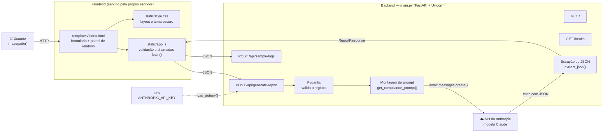
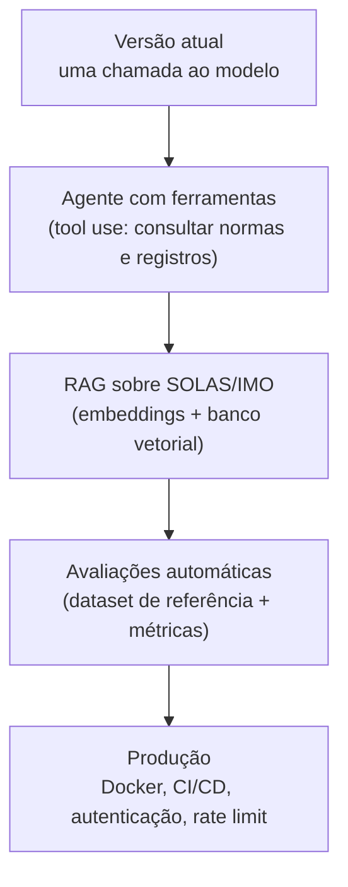

# Arquitetura — FPSO Compliance Report Generator

Aplicação web que transforma registros de turno de uma plataforma FPSO em relatórios de conformidade SOLAS/IMO, usando a API da Anthropic (Claude).

## 1. Visão geral



## 2. Componentes

| Componente | Arquivo | Responsabilidade |
|---|---|---|
| Interface | `templates/index.html` | Estrutura da página: formulário do turno e área do relatório |
| Lógica da interface | `static/app.js` | Lê o formulário, valida o JSON de equipamentos, chama a API e desenha o relatório |
| Estilo | `static/style.css` | Layout em duas colunas, responsivo, tema escuro |
| Servidor web | `main.py` (FastAPI) | Expõe as rotas HTTP e a documentação automática em `/docs` |
| Validação | `main.py` (Pydantic) | Garante tipos e tamanhos máximos dos campos antes de gastar tokens |
| Prompt | `get_compliance_prompt()` | Monta as instruções e os dados do turno para o modelo |
| Parser | `extract_json()` | Converte a resposta do modelo em um objeto Python |
| Configuração | `.env` | Guarda a chave da API fora do código |

## 3. Fluxo de uma geração de relatório

```mermaid
sequenceDiagram
    autonumber
    actor U as Usuário
    participant JS as app.js
    participant API as FastAPI (main.py)
    participant P as Pydantic
    participant C as Claude (Anthropic)

    U->>JS: Clica em "Generate Compliance Report"
    JS->>JS: Valida o JSON de Equipment Status
    JS->>API: POST /api/generate-report (JSON)
    API->>P: Valida tipos e tamanhos (ReportRequest)
    alt Dados inválidos
        P-->>API: Erro de validação
        API-->>JS: 422 Unprocessable Entity
    else Dados válidos
        API->>API: Monta o prompt com os dados entre tags <logs>
        API->>C: await messages.create(model, prompt)
        alt Falha na API (sem créditos, rede, etc.)
            C-->>API: APIError
            API-->>JS: 502 mensagem genérica (detalhe só no log)
        else Sucesso
            C-->>API: Texto (idealmente JSON)
            API->>API: extract_json(); se falhar, usa o texto bruto
            API-->>JS: 200 ReportResponse
        end
    end
    JS->>U: Mostra as seções do relatório (textContent)
```

## 4. Endpoints

| Método | Rota | Descrição | Códigos principais |
|---|---|---|---|
| GET | `/` | Página principal | 200 |
| GET | `/health` | Estado do serviço e se a chave está configurada | 200 |
| POST | `/api/sample-logs` | Registro de exemplo para testes | 200 |
| POST | `/api/generate-report` | Gera o relatório de conformidade | 200, 400, 422, 500, 502 |
| GET | `/docs` | Documentação interativa (Swagger, gerada automaticamente) | 200 |

## 5. Decisões de segurança

| Ponto | Situação anterior | Situação atual |
|---|---|---|
| CORS | `allow_origins=["*"]` com `allow_credentials=True` | Nenhuma origem externa por padrão; liberada só via `ALLOWED_ORIGINS` |
| Erros | Mensagem da API da Anthropic devolvida ao cliente | Detalhe só no log do servidor; cliente recebe mensagem genérica (502) |
| Tamanho da entrada | Sem limite | Limites por campo (Pydantic) para conter custo e abuso |
| Prompt injection | Dados do usuário misturados às instruções | Dados entre tags `<logs>`, marcados como não confiáveis |
| XSS na interface | — | Relatório renderizado com `textContent`, nunca `innerHTML` |
| Chave da API | Em `.env` (ignorado pelo Git) | Mantida igual; nunca versionada nem exibida no `/health` |
| Caminhos de arquivo | Relativos ao diretório de execução | Absolutos, a partir de `BASE_DIR` |

**Pendências conhecidas:** não há autenticação nem limite de requisições por usuário. Antes de publicar na internet, é recomendável adicionar ambos.

## 6. Como executar

```bash
pip install -r requirements.txt
echo "ANTHROPIC_API_KEY=sua-chave" > .env
fastapi dev main.py
```

Abra `http://127.0.0.1:8000/` no navegador.

Variáveis de ambiente opcionais:

| Variável | Padrão | Função |
|---|---|---|
| `ANTHROPIC_API_KEY` | — (obrigatória) | Chave da API |
| `ANTHROPIC_MODEL` | `claude-opus-5` | Modelo usado na geração |
| `ALLOWED_ORIGINS` | vazio | Origens externas liberadas por CORS, separadas por vírgula |

## 7. Roteiro para a apresentação (cerca de 3 minutos)

1. **Problema:** equipes de FPSO precisam documentar cada turno conforme as normas SOLAS/IMO. Fazer isso à mão é lento e sujeito a erro.
2. **Solução:** o operador preenche o registro do turno em um formulário; o sistema gera um relatório estruturado com checklist de conformidade.
3. **Demonstração:** clicar em *Load sample*, depois em *Generate*, e mostrar as seções do relatório.
4. **Arquitetura:** explicar o fluxo do diagrama da seção 1 (interface → FastAPI → validação → prompt → Claude → resposta).
5. **Segurança:** citar a tabela da seção 5, em especial o tratamento de erros e os limites de entrada.
6. **Próximos passos:** agente com ferramentas (consulta a normas), RAG sobre regulamentos reais, testes automatizados e Docker.

## 8. Evolução prevista


